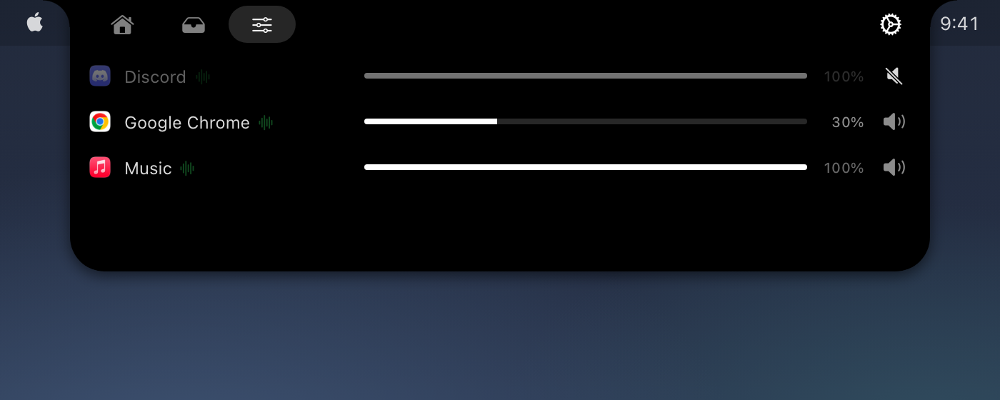

# Notch

A personal fork of [boring.notch](https://github.com/TheBoredTeam/boring.notch) that adds a **per-app volume mixer** to the notch and the menu bar.

[Watch the demo video](demo/mixer-demo.mp4)

## What it adds

- **Mixer tab in the notch.** Turn each app's volume up or down, or mute it, on its own.
- **Mixer in the menu bar.** The same controls under the slider icon.
- **Only apps making sound.** An app shows up while it plays and leaves a few seconds after it stops.
- Everything else from boring.notch: music controls, calendar, file shelf and HUD replacement.

## Download

1. Download `Notch.zip` from the [latest release](https://github.com/shamsharoon/notch/releases/latest).
2. Unzip it and drag **Notch** into your Applications folder.
3. Open Notch. macOS says it can't verify the developer, because this app isn't signed with a paid Apple developer account. Click **Done**.
4. Open **System Settings → Privacy & Security**, scroll down, and click **Open Anyway** next to Notch. You only do this once.
5. The first time you move a mixer slider, macOS asks for **System Audio Recording** permission. Allow it. Notch only changes each app's volume. It never records, saves or sends your audio.

Needs macOS 14.2 or newer. Works on Apple-chip and Intel Macs.

If you already run boring.notch, quit it first so the two don't fight over the notch.

## Build it yourself

Open `boringNotch.xcodeproj` in Xcode and run the `boringNotch` scheme.

## Credit and license

Built on [boring.notch](https://github.com/TheBoredTeam/boring.notch) by TheBoredTeam and its contributors. The original README is in [docs/UPSTREAM-README.md](docs/UPSTREAM-README.md).

Licensed under GPL-3.0, the same as boring.notch. See [LICENSE](LICENSE).
